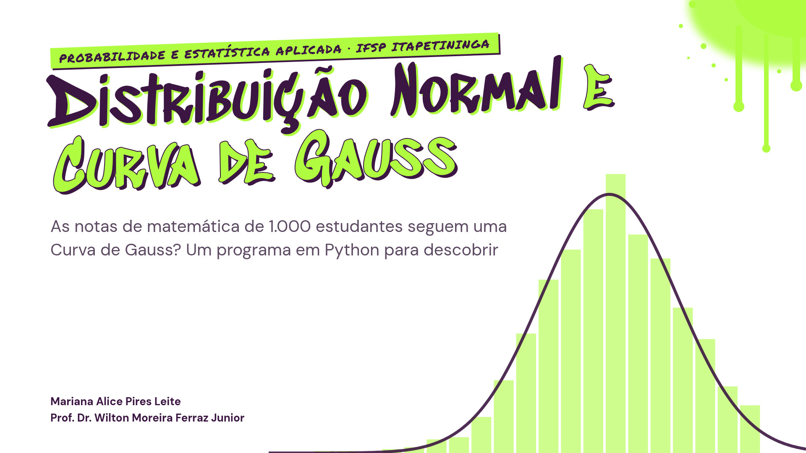

# Distribuição Normal e Curva de Gauss



Apresentação de **cerca de 10 minutos** para a disciplina **Probabilidade e Estatística Aplicada** do IFSP Câmpus Itapetininga, com o Prof. Dr. Wilton Moreira Ferraz Junior.

> **A pergunta do trabalho:** as notas de matemática de 1.000 estudantes seguem uma Curva de Gauss?
>
> **A resposta, em uma frase:** seguem **aproximadamente**. O formato é de sino e a regra 68–95–99,7 quase bate, mas as notas são inteiras, presas entre 0 e 100 e têm uma leve assimetria.

---

## Sumário

1. [Comece aqui: abrir em 30 segundos](#1-comece-aqui-abrir-em-30-segundos)
2. [Os conceitos em linguagem simples](#2-os-conceitos-em-linguagem-simples)
3. [O que tem em cada slide](#3-o-que-tem-em-cada-slide)
4. [Como apresentar](#4-como-apresentar)
5. [Como os números chegam aos slides](#5-como-os-números-chegam-aos-slides)
6. [Como editar](#6-como-editar)
7. [O visual: arte de rua](#7-o-visual-arte-de-rua)
8. [Mapa da pasta](#8-mapa-da-pasta)
9. [Deu problema?](#9-deu-problema)
10. [Créditos e licenças](#10-créditos-e-licenças)

---

## 1. Comece aqui: abrir em 30 segundos

Você **não precisa instalar nada**.

| Passo | O que fazer |
|:---:|---|
| 1 | Dê **duplo clique** no arquivo `apresentacao.html` (abre no Chrome, Edge ou Firefox). |
| 2 | Aperte **`F`** para ficar em tela cheia. |
| 3 | Use as **setas do teclado** para passar os slides. |

Pronto. Funciona até **sem internet**, porque tudo o que a apresentação usa (o reveal.js, as fontes e os dados) já está dentro da pasta.

> **Importante:** o `apresentacao.html` precisa ficar junto das pastas `assets/` e `vendor/`. Se for levar num pendrive, copie a **pasta inteira**.

---

## 2. Os conceitos em linguagem simples

Se você nunca viu o assunto, este resumo ajuda a acompanhar os slides.

| Conceito | Em poucas palavras | Nas notas desta base |
|---|---|---|
| **Média** (x̄) | Soma tudo e divide pela quantidade. É o "centro de gravidade" dos dados. | 66,09 |
| **Mediana** | O valor do meio quando as notas estão em ordem. | 66 |
| **Moda** | A nota que mais aparece. | 65 (36 vezes) |
| **Desvio-padrão** (s) | O quanto as notas costumam se afastar da média. Quanto maior, mais espalhadas. | 15,16 |
| **Assimetria** (g) | Diz se um dos lados tem a "cauda" mais comprida. Zero é simétrico. | −0,28 (leve, cauda das notas baixas) |
| **Curva de Gauss** | O gráfico em forma de **sino**: muitos valores no meio e poucos nas pontas. | A curva acompanha bem o histograma |
| **Regra 68–95–99,7** | Numa normal, cerca de 68% dos valores ficam a até 1 desvio da média, 95% a até 2 e 99,7% a até 3. | 69,6%, 95,4% e 99,6% |
| **Escore z** | Quantos desvios-padrão uma nota está acima (z positivo) ou abaixo (z negativo) da média. | Nota 75 tem z = 0,59 |
| **Valor atípico** | Valor muito longe da média. Aqui, notas com \|z\| maior que 3. | 0, 8, 18 e 19 |

A fórmula do escore z é simples:

```
z = (nota − média) / desvio-padrão
```

Exemplo: para a nota 75, `z = (75 − 66,09) / 15,16 ≈ 0,59`, ou seja, pouco mais de meio desvio acima da média.

> **Regra do trabalho:** nenhuma biblioteca estatística pronta (`statistics`, `scipy.stats`, `numpy.mean`...). Toda fórmula foi programada à mão, usando só `csv`, `math` e o `matplotlib` para desenhar.

---

## 3. O que tem em cada slide

A apresentação segue as **Partes A a G** da atividade. A coluna "Interação" mostra o que dá para clicar ao vivo.

| # | Slide | Parte | Tempo | Interação |
|:---:|---|:---:|:---:|---|
| 1 | Capa | | 0:20 | Histograma e curva se desenham sozinhos |
| 2 | Ler os dados, calcular, desenhar e concluir | Objetivo | 0:40 | |
| 3 | A Curva de Gauss | A | 0:55 | Controles de μ e σ mudam a curva |
| 4 | Regra 68–95–99,7 e escore z | A | 0:45 | Botões ±1σ, ±2σ e ±3σ |
| 5 | Um arquivo, uma função para cada parte | Código | 0:30 | |
| 6 | Leitura com `csv.DictReader` | B | 0:45 | Código avança em 6 passos |
| 7 | Medidas sem biblioteca estatística | C | 0:50 | Código avança em 5 passos |
| 8 | Resultados das medidas | C | 0:40 | 2 cliques com a interpretação |
| 9 | A regra funciona nas notas? | D | 0:50 | Histograma real com o intervalo destacado |
| 10 | Onde fica cada nota? | E | 0:50 | Calculadora de escore z |
| 11 | Montando o gráfico | F | 0:45 | Camadas do gráfico ligadas por botões |
| 12 | Arquivos gerados pelo programa | F | 0:20 | |
| 13 | Respondendo às perguntas | G | 0:50 | |
| 14 | Aproximadamente normal, mas não perfeitamente | G | 0:40 | |
| 15 | Obrigada! Perguntas? | | 0:10 | |
| | **Total** | | **9:50** | |

---

## 4. Como apresentar

### Teclas que você vai usar

| Tecla | O que faz |
|:---:|---|
| `→` ou espaço | Próximo slide ou próximo passo (trechos de código, cartões) |
| `←` | Volta |
| `F` | Tela cheia |
| `S` | Abre a **janela do apresentador**, com as notas de fala, o próximo slide e um relógio |
| `T` | Mostra ou esconde um **cronômetro de 10 minutos** no canto da tela |
| `R` | Reinicia o cronômetro |
| `O` ou `Esc` | Mostra todos os slides de uma vez |
| `B` ou `.` | Apaga a tela (bom para chamar a atenção para você) |

O cronômetro fica **verde-limão** nos últimos 2 minutos e **vermelho** quando o tempo acaba, mostrando quanto passou.

### No dia, passo a passo

1. Abra o `apresentacao.html` no computador da sala.
2. Aperte `F` (tela cheia).
3. Aperte `S` e arraste a janela do apresentador para a tela do notebook. Só você vê as notas de fala.
4. Quando começar a falar, aperte `T` para ligar o cronômetro.

### O que dizer em cada slide

As **notas de fala** estão no `slides.md`, logo depois da linha `Note:` de cada slide. Cada nota começa com o tempo previsto, por exemplo `(45 segundos)`. Elas aparecem na janela do apresentador (tecla `S`).

### Animações

Ao passar de slide, ele **desliza para o lado**. Depois, o conteúdo entra como arte de rua:

1. a tinta verde-limão escorre do canto;
2. a etiqueta acima do título se desenrola como **fita adesiva**;
3. o título aparece como **spray** saindo de foco;
4. cartões, gráficos e códigos caem um depois do outro, como **adesivos**.

Tudo leva cerca de 1,5 segundo. As animações não aparecem no PDF nem quando o computador está configurado para reduzir movimento.

Mais dicas, como exportar para PDF, em [`docs/como-rodar.md`](docs/como-rodar.md).

---

## 5. Como os números chegam aos slides

Nenhum número dos slides foi digitado à mão. Eles são **calculados a partir do arquivo de dados**, com as mesmas fórmulas do `analise_distribuicao_normal.py`:

```
dados/StudentsPerformance.csv      as notas originais (1.000 linhas)
        │
        │  python3 build.py        lê a coluna "math score"
        ▼
assets/dados.js                    lista com as 1.000 notas
        │
        │  assets/graficos.js      calcula média, desvio, z...
        ▼
slides (apresentacao.html)         números e gráficos interativos
```

Se você trocar o CSV e rodar `python3 build.py`, **todos os números e gráficos se atualizam sozinhos**.

---

## 6. Como editar

Todo o texto dos slides fica em **um único arquivo: `slides.md`**. Ele é escrito em Markdown, com um pouco de HTML.

| Quero... | Faço assim |
|---|---|
| Mudar um texto | Edite o `slides.md`. Cada slide é separado por uma linha com `---`. |
| Mudar o que vou falar | Edite o texto depois de `Note:` no slide. |
| Ver a mudança na hora | Rode o servidor local (abaixo) e aperte `F5` no navegador. |
| Atualizar o arquivo de duplo clique | Rode `python3 build.py`. |
| Mudar cores, fontes ou animações | Edite o `assets/tema.css`. |

### Ver as mudanças na hora

```bash
cd apresentacao-distribuicao-normal
python3 -m http.server 8000
```

Abra **http://localhost:8000** no navegador. Esse modo lê o `slides.md` direto: salve o arquivo e aperte `F5`.

### Depois de editar

```bash
python3 build.py
```

Esse comando gera de novo o `apresentacao.html`. **Sem ele, o duplo clique continua mostrando a versão antiga.**

Mais detalhes em [`docs/como-editar.md`](docs/como-editar.md).

---

## 7. O visual: arte de rua

O design imita **grafite**: fundo branco, como um muro limpo, e detalhes em roxo e verde-limão.

| Elemento | Como é |
|---|---|
| Cores principais | Roxo `#3C1642` e verde-limão `#AFFC41` |
| Cores de apoio | Petróleo `#086375`, turquesa `#1DD3B0` e menta `#B2FF9E` ([paleta no Coolors](https://coolors.co/3c1642-086375-1dd3b0-affc41-b2ff9e)) |
| Títulos | Fonte **Sedgwick Ave Display**, em roxo com sombra verde-limão |
| Etiquetas, números e botões | Fonte **Permanent Marker**, que parece escrita com marcador |
| Texto corrido | Fonte **DM Sans**, para ler de longe sem esforço |
| Cartões | Parecem adesivos, com borda roxa grossa e sombra verde-limão |
| Manchas | Spray com escorridos nos cantos (`assets/spray-lima.svg` e `assets/spray-roxo.svg`) |
| Código | Fundo roxo quase preto com cores de alto contraste, para a turma ler do fundo da sala |

---

## 8. Mapa da pasta

```
apresentacao-distribuicao-normal/
├── README.md              este guia
├── apresentacao.html      ABRA ESTE (duplo clique). É gerado pelo build.py
├── slides.md              todo o texto dos slides e as notas de fala
├── index.html             modelo usado pelo build.py (precisa de servidor local)
├── build.py               lê o CSV e gera o apresentacao.html
├── dados/
│   └── StudentsPerformance.csv     a base de dados original
├── assets/
│   ├── tema.css           cores, fontes, adesivos e animações
│   ├── fontes.css         carrega as fontes locais
│   ├── graficos.js        cálculos e gráficos interativos
│   ├── dados.js           notas extraídas do CSV (gerado, não editar)
│   ├── spray-lima.svg     mancha de spray verde-limão
│   ├── spray-roxo.svg     respingos roxos
│   ├── histograma_curva_normal.png   gerado pelo programa em Python
│   └── boxplot.png                   gerado pelo programa em Python
├── docs/
│   ├── como-rodar.md      como abrir, apresentar e exportar em PDF
│   ├── como-editar.md     como mudar textos, cores e gráficos
│   └── imagens/capa.png   a imagem do topo deste guia
└── vendor/                bibliotecas de terceiros (não editar)
    ├── reveal/            reveal.js 5.2.1
    └── fonts/             arquivos das fontes
```

---

## 9. Deu problema?

| O que aconteceu | Como resolver |
|---|---|
| Apareceu a tela "Quase lá!" | Você abriu o `index.html`. Abra o **`apresentacao.html`**. |
| Os gráficos estão vazios | Rode `python3 build.py` para gerar o `assets/dados.js`. |
| Editei o `slides.md` e nada mudou | Rode `python3 build.py` de novo e recarregue a página. |
| As letras estão diferentes | Confira se a pasta `vendor/fonts` foi copiada junto. |
| As setas não trocam de slide | Você está com o campo de nota selecionado (slide 10). Clique fora dele. |
| As imagens do Python não aparecem | Confira se `assets/histograma_curva_normal.png` e `assets/boxplot.png` existem. |
| O computador da sala bloqueou o HTML | Use o PDF de reserva. O passo a passo está em [`docs/como-rodar.md`](docs/como-rodar.md). |

---

## 10. Créditos e licenças

- **Dados:** base *Students Performance in Exams*, do Kaggle.
- **reveal.js:** licença MIT (`vendor/reveal/LICENSE`).
- **Fontes:** Sedgwick Ave Display, Permanent Marker, DM Sans, Space Grotesk e Caveat, todas sob a SIL Open Font License 1.1, obtidas pelo projeto Fontsource.
