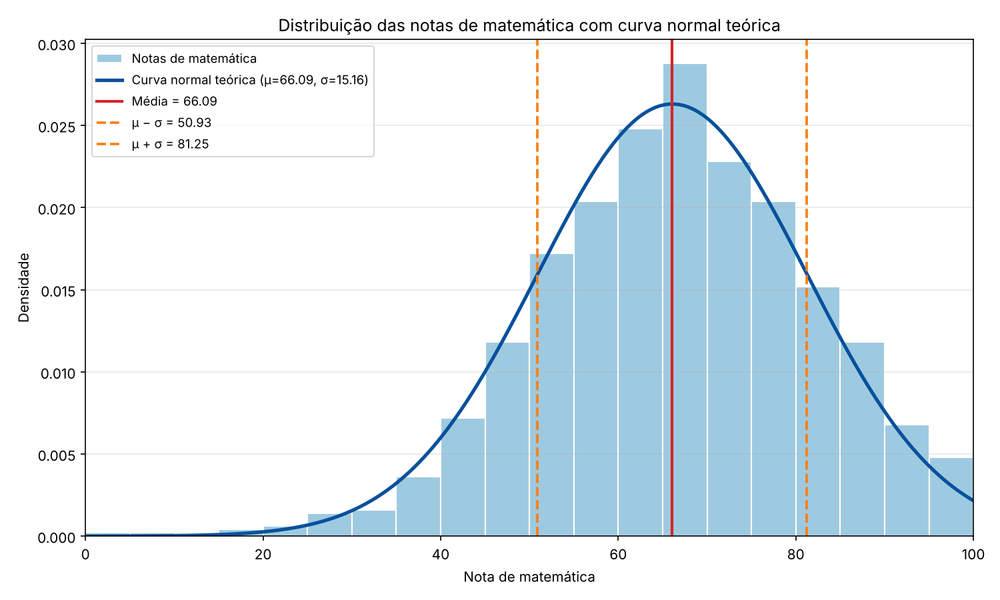
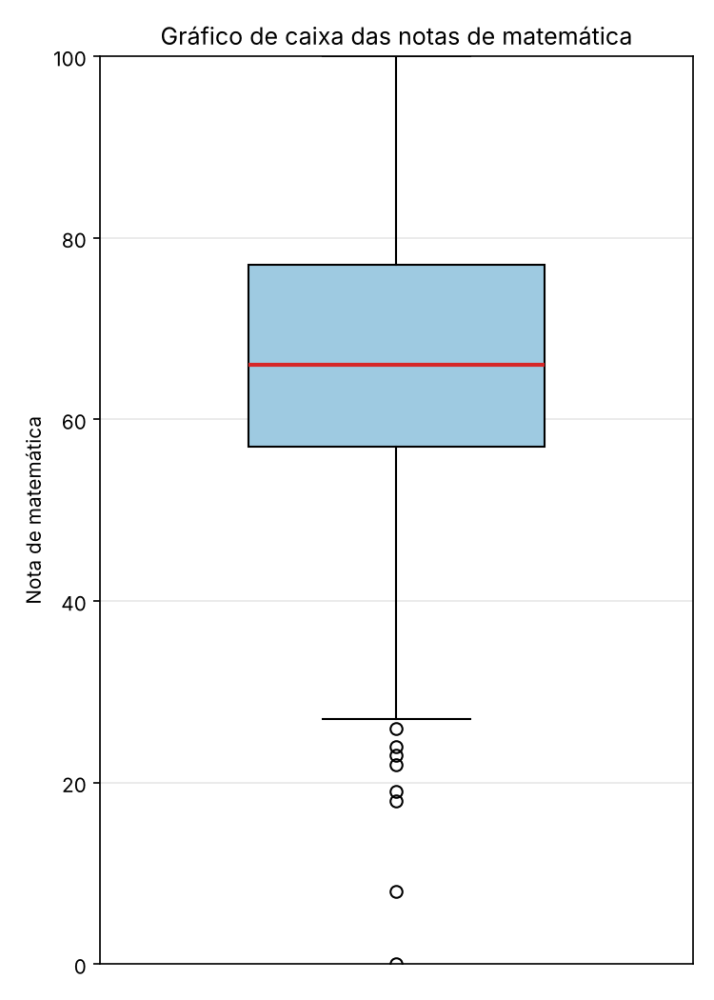

<!-- .slide: class="claro capa" data-background-color="#FFFFFF" -->

<canvas class="fundo-sino" width="1920" height="1080" aria-hidden="true"></canvas>

Probabilidade e Estatística Aplicada · IFSP Itapetininga

<h1 class="titulo-capa">Distribuição Normal e Curva de Gauss</h1>

As notas de matemática de 1.000 estudantes seguem uma Curva de Gauss? Um programa em Python para descobrir

Mariana Alice Pires Leite (3043151) Prof. Dr. Wilton Moreira Ferraz Junior

Note:
(20 segundos) Bom dia ou boa noite, professor e turma. Meu nome é Mariana e o meu trabalho é sobre distribuição normal, a Curva de Gauss. A pergunta que eu quis responder é se as notas de matemática de mil estudantes se comportam como uma Curva de Gauss, e para isso eu desenvolvi um programa em Python que faz toda a análise a partir dos dados brutos.

---

<!-- .slide: class="claro" data-background-color="#FFFFFF" -->

O que a atividade pede

## Ler os dados, calcular, desenhar e concluir

A base

<h3>Students Performance in Exams</h3>

<b>1000 estudantes</b> e 8 colunas, com dados dos alunos e notas de matemática, leitura e escrita.

Variável analisada <code>math score</code>, notas inteiras de 0 a 100.

Pode usar

<code>csv</code><code>math</code><code>matplotlib</code>

O <code>matplotlib</code> serve <b>só para os gráficos</b>. Toda conta é feita à mão no código.

Não pode usar

<code>statistics</code><code>scipy.stats</code><code>numpy.mean</code><code>numpy.std</code><code>pandas.mean</code><code>pandas.std</code>

E nenhum resultado pode ser digitado à mão.

O trabalho tem sete partes. <b>A</b> teoria, <b>B</b> leitura, <b>C</b> medidas, <b>D</b> regra 68–95–99,7, <b>E</b> escore z, <b>F</b> gráficos e <b>G</b> conclusão.

Note:
(40 segundos) A base é a Students Performance in Exams, do Kaggle, com mil estudantes e oito colunas. Eu analisei a coluna math score, que são as notas de matemática de zero a cem. A atividade tinha uma regra importante, que era não usar bibliotecas estatísticas prontas. Então eu só podia usar o csv e o math, que são da biblioteca padrão do Python, e o matplotlib apenas para desenhar. Média, desvio-padrão e todo o resto eu programei com as fórmulas. O trabalho segue sete partes, da teoria até a conclusão, e a apresentação segue essa mesma ordem.

---

<!-- .slide: class="claro" data-background-color="#FFFFFF" -->

Parte A · Teoria

<h2>A Curva de Gauss</h2>
<ul>
<li>Distribuição <b>contínua</b>, simétrica e em formato de <b>sino</b></li>
<li><b>Média, mediana e moda</b> são iguais e ficam no centro</li>
<li>As caudas nunca tocam o eixo e a <b>área total é 1</b></li>
</ul>

<i>f</i>(<i>x</i>) = 1<i>σ</i>√2π <i>e</i>−(<i>x</i>−<i>μ</i>)² / 2<i>σ</i>²

<b class="azul">μ</b> é o centro da curva. <b>σ</b> é o quanto ela se espalha.

<canvas class="curva-parametros" width="1000" height="560" aria-label="Curva normal que muda com a média e o desvio-padrão"></canvas>

<label>μ <input type="range" data-param="mu" min="30" max="90" step="1"><output data-out="mu">66</output></label>
<label>σ <input type="range" data-param="sigma" min="8" max="30" step="1"><output data-out="sigma">15</output></label>
<button class="btn" data-reset>valores da base</button>

A linha tracejada cinza é a curva com a média e o desvio das notas reais.

Note:
(55 segundos) A distribuição normal é contínua, simétrica e tem formato de sino. Nela a média, a mediana e a moda coincidem no centro, e a área total embaixo da curva vale um, que representa cem por cento de probabilidade. Ela depende de dois parâmetros. Aqui eu mostro mexendo nos controles. Quando eu mudo o mu, a curva inteira anda para a direita ou para a esquerda, então a média define a posição. Quando eu aumento o sigma, a curva fica mais baixa e larga, e quando diminuo ela fica alta e estreita, então o desvio-padrão define a dispersão. A área continua sendo um em todos os casos. Termino clicando em valores da base para voltar para a curva das notas.

---

<!-- .slide: class="claro" data-background-color="#FFFFFF" -->

Parte A · Teoria

<h2>Regra 68–95–99,7 e escore z</h2>

Em dados normais, a parte dos valores perto da média é <b>sempre a mesma</b>, não importa quanto valem μ e σ.

<i>z</i> = <i>x</i> − <i>μ</i><i>σ</i>

O escore z diz <b>quantos desvios-padrão</b> um valor está acima (z &gt; 0) ou abaixo (z &lt; 0) da média.

Como só 0,27% dos valores ficam além de 3σ, notas com <b>|z| &gt; 3</b> são tratadas como <b>possíveis valores atípicos</b>.

<canvas class="curva-regra" width="1000" height="560" aria-label="Curva normal padrão com as faixas de um, dois e três desvios-padrão"></canvas>

<button class="btn ativo" data-k="1">± 1σ</button>
<button class="btn" data-k="2">± 2σ</button>
<button class="btn" data-k="3">± 3σ</button>

Note:
(45 segundos) Uma consequência da forma da curva é a regra empírica. Clicando nos botões eu mostro que cerca de sessenta e oito por cento dos valores ficam a até um desvio-padrão da média, noventa e cinco por cento a até dois e noventa e nove vírgula sete por cento a até três. Isso vale para qualquer normal. O escore z traduz um valor para essa régua, dizendo quantos desvios-padrão ele está acima ou abaixo da média. Como quase nada passa de três desvios, um valor com módulo de z maior que três é considerado um possível valor atípico.

---

<!-- .slide: class="claro" data-background-color="#FFFFFF" -->

Como o programa está organizado

## Um arquivo, uma função para cada parte

Parte B
<h3>Ler</h3><code>carregar_notas()</code>
CSV vira lista de notas

Parte C
<h3>Medir</h3><code>media() mediana() modas() ...</code>
Medidas com as fórmulas

Parte D
<h3>Contar</h3><code>regra_empirica()</code>
Notas em x ± k·s

Parte E
<h3>Padronizar</h3><code>escore_z()</code>
z e valores atípicos

Parte F
<h3>Desenhar</h3><code>gerar_histograma()</code>
PNG com a curva

Para rodar

python analise_distribuicao_normal.py

O que sai

Todos os resultados no terminal, separados por parte, mais <code>histograma_curva_normal.png</code> e <code>boxplot.png</code>.

Note:
(30 segundos) Antes de entrar nos resultados, mostro como o código está organizado. É um único arquivo, analise distribuição normal ponto py, e cada parte da atividade virou uma função. A carregar notas lê o arquivo, as funções de medidas fazem os cálculos da Parte C, a regra empírica conta as notas nos intervalos, a escore z padroniza e a gerar histograma desenha o gráfico. A função main chama tudo nessa ordem e imprime os resultados no terminal, separados por parte.

---

<!-- .slide: class="claro" data-background-color="#FFFFFF" -->

Parte B · Leitura e organização dos dados

analise_distribuicao_normal.py · carregar_notas()

<pre><code class="language-python" data-trim data-line-numbers="1-2|3-4|5-7|8-12|13-15|16">
with open(caminho, newline="", encoding="utf-8") as arquivo:
    leitor = csv.DictReader(arquivo)
    for numero_linha, registro in enumerate(leitor, start=2):
        valor = registro.get("math score")
        if valor is None or valor.strip() == "":
            problemas.append((numero_linha, "valor ausente"))
            continue
        try:
            nota = int(valor.strip())
        except ValueError:
            problemas.append((numero_linha, "valor inválido"))
            continue
        if nota &lt; 0 or nota &gt; 100:
            problemas.append((numero_linha, "fora de 0-100"))
            continue
        notas.append(nota)
</code></pre>

O que acontece

<b>DictReader</b> transforma cada linha em um dicionário, então a nota é lida pelo nome da coluna.

Cada valor passa por <b>três testes</b>, se está vazio, se vira inteiro com <code>int()</code> e se está entre 0 e 100.

As notas aprovadas vão para uma <b>lista</b> e os problemas são guardados com o número da linha.

Registros lidos

1000

Ausentes ou inválidos

0

Note:
(45 segundos) Na Parte B, o arquivo é aberto com o módulo csv e lido com o DictReader, que transforma cada linha em um dicionário. Assim eu acesso a nota pelo nome da coluna, math score. Vou avançando o código com as setas. Para cada valor o programa faz três testes. Primeiro vê se está vazio, depois tenta converter para inteiro, e se não der é inválido, e por último confere se está entre zero e cem. O que passa nos testes vai para a lista de notas. O resultado foi que as mil notas foram lidas e nenhuma estava ausente ou inválida.

---

<!-- .slide: class="claro" data-background-color="#FFFFFF" -->

Parte C · Medidas sem biblioteca estatística

analise_distribuicao_normal.py

<pre style="font-size:19px"><code class="language-python" data-trim data-line-numbers="1-5|6-11|12-17|18-22|23-27">
def media(dados):
    total = 0
    for x in dados:
        total += x
    return total / len(dados)
def mediana(dados):
    ordenados = sorted(dados)
    n, meio = len(ordenados), len(ordenados) // 2
    if n % 2 == 1:
        return ordenados[meio]
    return (ordenados[meio - 1] + ordenados[meio]) / 2
def modas(dados):
    frequencias = {}
    for x in dados:
        frequencias[x] = frequencias.get(x, 0) + 1
    maior = max(frequencias.values())
    return [v for v, f in frequencias.items() if f == maior], maior
def variancia_amostral(dados, m):
    soma_quadrados = 0
    for x in dados:
        soma_quadrados += (x - m) ** 2
    return soma_quadrados / (len(dados) - 1)   # s = math.sqrt(...)
def coeficiente_assimetria(dados, m, s):
    n, soma_cubos = len(dados), 0
    for x in dados:
        soma_cubos += ((x - m) / s) ** 3
    return n / ((n - 1) * (n - 2)) * soma_cubos
</code></pre>

<i>x̄</i> = Σ <i>xi</i><i>n</i>

Mediana é o valor central da lista ordenada. Com <i>n</i> par, é a média dos dois do meio.

Moda é a nota mais frequente. O código devolve <b>todas</b> as que empatam.

<i>s</i>² = Σ (<i>xi</i> − <i>x̄</i>)²<i>n</i> − 1 &nbsp; <i>s</i> = √<i>s</i>²

<i>g</i> = <i>n</i>(<i>n</i>−1)(<i>n</i>−2) Σ (<i>xi</i> − <i>x̄</i><i>s</i>)³

Divide por <i>n</i> − 1 porque a média veio dos próprios dados, o que deixaria a dispersão um pouco subestimada.

Note:
(50 segundos) Na Parte C cada medida virou uma função que segue a fórmula. A média soma as notas com um laço e divide pela quantidade. A mediana ordena a lista e, como mil é par, faz a média dos dois valores do meio. A moda monta um dicionário de frequências e devolve todas as notas que empatam na maior frequência, então o código também funcionaria se houvesse mais de uma moda. A variância amostral soma os desvios ao quadrado e divide por n menos um, e o desvio-padrão é a raiz dela, usando só o math ponto sqrt. Por último, o coeficiente de assimetria eleva os desvios padronizados ao cubo, o que mantém o sinal e mostra para que lado a cauda é mais longa.

---

<!-- .slide: class="claro" data-background-color="#FFFFFF" -->

Parte C · Resultados

## O centro está em 66 e o espalhamento em 15 pontos

Quantidade

1000

Menor nota

0

Maior nota

100

Amplitude

100

Moda

65

36 vezes

Média

66,09

Mediana

66

Variância

229,92

Desvio-padrão

15,16

Assimetria

−0,28

Média, mediana e moda

<b>Quase iguais</b>, como numa normal. A diferença entre média e mediana é de menos de 0,1 ponto.

Assimetria g = −0,2789

Negativa e com |g| &lt; 0,5, então é uma <b>assimetria leve</b>, com a cauda das notas baixas um pouco mais longa.

Note:
(40 segundos) Esses números são os que o programa calculou, e aqui na apresentação eles também são calculados a partir do CSV, não foram digitados. As notas vão de zero a cem. A média deu sessenta e seis vírgula zero nove, a mediana sessenta e seis e a moda sessenta e cinco, que aparece trinta e seis vezes. O desvio-padrão é de quinze pontos. No primeiro clique eu destaco que as três medidas de centro são quase iguais, como numa normal. No segundo, que a assimetria deu menos zero vírgula vinte e oito, uma assimetria negativa leve, ou seja, a cauda das notas baixas é um pouco mais comprida.

---

<!-- .slide: class="claro" data-background-color="#FFFFFF" -->

<canvas class="hist-regra" width="1040" height="600" aria-label="Histograma das notas com o intervalo de k desvios-padrão destacado"></canvas>

<button class="btn ativo" data-k="1">± 1 desvio</button>
<button class="btn" data-k="2">± 2 desvios</button>
<button class="btn" data-k="3">± 3 desvios</button>

Parte D · Regra 68–95–99,7

<h2>A regra funciona nas notas?</h2>
<table class="tabela">
<tr><th>Faixa</th><th>Qtd.</th><th>Obs.</th><th>Esp.</th></tr>
<tr data-linha="1"><td>x ± 1s</td><td class="num" data-calc="r1q">696</td><td class="num">69,6%</td><td class="num">68%</td></tr>
<tr data-linha="2"><td>x ± 2s</td><td class="num" data-calc="r2q">954</td><td class="num">95,4%</td><td class="num">95%</td></tr>
<tr data-linha="3"><td>x ± 3s</td><td class="num" data-calc="r3q">996</td><td class="num">99,6%</td><td class="num">99,7%</td></tr>
</table>

<b>Sim.</b> A maior diferença é de +1,6 ponto percentual.

No código, um laço conta quantas notas ficam entre <code>m - k*s</code> e <code>m + k*s</code> para k = 1, 2 e 3.

Note:
(50 segundos) Na Parte D, a função regra empírica calcula os limites média menos k desvios e média mais k desvios, e conta quantas notas ficam dentro. No gráfico, cada barra é uma nota e as barras claras são as que estão dentro do intervalo. Com um desvio, entre cinquenta e um e oitenta e um, ficaram seiscentas e noventa e seis notas, sessenta e nove vírgula seis por cento, contra sessenta e oito esperados. Clico em dois desvios e dá noventa e cinco vírgula quatro, contra noventa e cinco. Em três desvios dá noventa e nove vírgula seis, contra noventa e nove vírgula sete. Os valores ficaram muito próximos, e o primeiro intervalo um pouco acima mostra que as notas se concentram um pouco mais no centro. Um detalhe é que o limite de três desvios passa de cem, que é uma nota impossível.

---

<!-- .slide: class="claro" data-background-color="#FFFFFF" -->

Parte E · Escores padronizados

<h2>Onde fica cada nota?</h2>
<table class="tabela">
<tr><th>Caso</th><th>Nota</th><th>z</th></tr>
<tr><td>Menor nota</td><td class="num" data-calc="min">0</td><td class="num" style="color:#E4572E" data-calc="zmin" data-casas="4">−4,3585</td></tr>
<tr><td>Maior nota</td><td class="num" data-calc="max">100</td><td class="num" data-calc="zmax" data-casas="4">2,2364</td></tr>
<tr><td>Nota 50</td><td class="num">50</td><td class="num" data-calc="z50" data-casas="4">−1,0611</td></tr>
<tr><td>Nota 75</td><td class="num">75</td><td class="num" data-calc="z75" data-casas="4">0,5877</td></tr>
<tr><td>Nota 90</td><td class="num">90</td><td class="num" data-calc="z90" data-casas="4">1,5769</td></tr>
</table>

Na base inteira, <b>4 notas</b> têm |z| &gt; 3, que são <b>0, 8, 18, 19</b>, todas na cauda de baixo.

<canvas class="curva-z" width="1040" height="520" aria-label="Posição da nota escolhida na curva e seu escore z"></canvas>

<label>nota <input class="entrada" type="number" min="0" max="100" value="75" data-z></label>
<button class="btn" data-nota="0">0</button>
<button class="btn" data-nota="50">50</button>
<button class="btn" data-nota="75">75</button>
<button class="btn" data-nota="90">90</button>
<button class="btn" data-nota="100">100</button>

Note:
(50 segundos) Na Parte E a função escore z faz x menos a média, dividido pelo desvio-padrão. Aqui dá para testar qualquer nota. Com setenta e cinco, z dá zero vírgula cinquenta e nove, ou seja, pouco mais de meio desvio acima da média. Clico em cinquenta e dá menos um vírgula zero seis, cerca de um desvio abaixo. Noventa dá um vírgula cinquenta e oito e a maior nota, cem, dá dois vírgula vinte e quatro, então nenhuma delas é atípica. Por último clico em zero. O z dá menos quatro vírgula trinta e seis, mais de quatro desvios abaixo da média, e por isso a nota zero é um possível valor atípico. O programa percorreu a base inteira e achou quatro notas assim, zero, oito, dezoito e dezenove, os pontos vermelhos, todas na cauda de baixo.

---

<!-- .slide: class="claro" data-background-color="#FFFFFF" -->

<canvas class="hist-camadas" data-tema="claro" width="1040" height="600" aria-label="Histograma das notas com camadas que podem ser ligadas"></canvas>

<button class="btn ativo" data-camada="barras" style="--c:#5E9112">histograma</button>
<button class="btn" data-camada="curva" style="--c:#3C1642">curva normal</button>
<button class="btn" data-camada="media" style="--c:#086375">média</button>
<button class="btn" data-camada="sigma" style="--c:#0E9F84">± 1 desvio</button>

Parte F · Representação gráfica

<h2>Montando o gráfico</h2>

<pre style="font-size:20px"><code class="language-python" data-trim data-line-numbers="1-2|3-5|6-7|8-9">
classes = list(range(0, 105, 5))
ax.hist(dados, bins=classes, density=True)
xs = [i / 10 for i in range(0, 1001)]
ys = [densidade_normal(x, m, s) for x in xs]
ax.plot(xs, ys)
ax.axvline(m, color="red")
ax.axvline(m - s, linestyle="--")
ax.axvline(m + s, linestyle="--")
fig.savefig("histograma_curva_normal.png")
</code></pre>

<code>density=True</code> faz a área das barras valer <b>1</b>, igual à área da curva, e por isso os dois podem ser comparados.

Note:
(45 segundos) Na Parte F eu monto o gráfico em camadas, do mesmo jeito que o código faz. Primeiro o histograma com classes de cinco em cinco pontos, usando density igual a true, que transforma a altura das barras em densidade para que a área total seja um, igual à da curva. Clico em curva normal, que o programa desenha calculando a fórmula da densidade em mil e um pontos com a média e o desvio da base. Depois ligo a linha da média e as linhas de um desvio abaixo e acima. Dá para ver que a curva acompanha bem as barras, com o pico um pouco mais alto no centro e a cauda esquerda indo até o zero.

---

<!-- .slide: class="claro" data-background-color="#FFFFFF" -->

Parte F · Arquivos gerados pelo programa

## O que o Python salvou na pasta

histograma_curva_normal.png

boxplot.png (opcional)

A mediana fica no meio da caixa e os pontos soltos aparecem <b>só embaixo</b>, que são as notas atípicas.

Note:
(20 segundos) Esses são os arquivos que o próprio programa gerou, o histograma com a curva, que é o arquivo pedido na entrega, e o gráfico de caixa opcional. No gráfico de caixa a mediana fica bem no meio da caixa, então o centro dos dados é quase simétrico, e os pontos soltos aparecem só embaixo, que são justamente as notas atípicas.

---

<!-- .slide: class="claro" data-background-color="#FFFFFF" -->

Parte G · Conclusão

## Respondendo às perguntas

Sim<h3>Formato de sino?</h3>
Pico no centro e frequências caindo para os dois lados. A curva acompanha bem as barras.

Sim<h3>Média ≈ mediana?</h3>
66,089 contra 66, e a moda é 65.

Sim<h3>Perto de 68–95–99,7?</h3>
69,6%, 95,4% e 99,6%. Diferença máxima de 1,6 ponto.

Leve<h3>Há assimetria?</h3>
g = −0,28, negativa e leve. A cauda das notas baixas é mais longa.

Sim, 4<h3>Valores atípicos?</h3>
Notas 0, 8, 18, 19. São possíveis atípicos, não erros, e foram mantidas.

Não<h3>Normal perfeita?</h3>
Próximo slide.

Note:
(50 segundos) Na Parte G respondo às perguntas da atividade. O histograma tem formato de sino, sim. Média e mediana são próximas, sessenta e seis vírgula zero oito nove e sessenta e seis, com a moda em sessenta e cinco. Os percentuais ficaram muito próximos da regra, com no máximo um vírgula seis ponto de diferença. Existe assimetria, mas leve e negativa. E existem quatro possíveis valores atípicos, que eu mantive porque podem ser estudantes que realmente foram muito mal, e não erros na base. A última pergunta, se é uma normal perfeita, eu respondo no próximo slide.

---

<!-- .slide: class="claro" data-background-color="#FFFFFF" -->

Parte G · Conclusão

## Aproximadamente normal, mas não perfeitamente

Por que não é perfeita

<ul class="lista-grande">
<li>A normal é <b>contínua e infinita</b>. As notas são <b>inteiras e vão só de 0 a 100</b>. O limite de x + 3s deu <b>111,58</b>, uma nota impossível.</li>
<li>A normal é simétrica, e as notas têm <b>leve assimetria negativa</b>.</li>
<li>O centro é um pouco <b>mais concentrado</b> do que a curva prevê.</li>
<li>Usei análise <b>descritiva e visual</b>, não um teste formal de normalidade.</li>
</ul>

Conclusão mais cuidadosa

As notas de matemática têm <b>comportamento aproximadamente normal</b>. A Curva de Gauss é um <b>bom modelo</b> para descrever o desempenho da turma, desde que seja entendida como uma <b>aproximação</b> e não como uma descrição exata dos dados.

Note:
(40 segundos) Então, os dados seguem perfeitamente uma normal? Não. A normal é contínua e aceita qualquer valor, enquanto as notas são inteiras e presas entre zero e cem, tanto que o limite de três desvios deu cento e onze, uma nota que não existe. Além disso há uma leve assimetria e o centro é um pouco mais concentrado que o previsto, e eu fiz uma análise descritiva, não um teste formal. A conclusão mais cuidadosa é que as notas têm comportamento aproximadamente normal, e que a Curva de Gauss é um bom modelo para descrever a turma, desde que seja vista como uma aproximação.

---

<!-- .slide: class="claro capa" data-background-color="#FFFFFF" -->

<canvas class="fundo-sino" width="1920" height="1080" aria-hidden="true"></canvas>

Distribuição Normal e Curva de Gauss

<h1 class="titulo-capa">Obrigada!</h1>

Perguntas?

Mariana Alice Pires Leite (3043151) Prof. Dr. Wilton Moreira Ferraz Junior

Note:
(10 segundos) Essa foi a minha análise. Obrigada pela atenção, e fico à disposição para perguntas.
